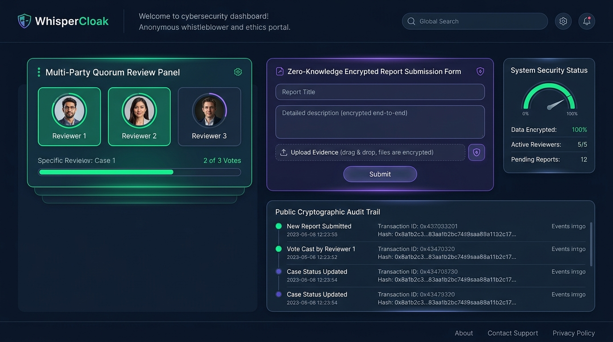

[](https://tide.org/tidecloak?utm_source=github&utm_medium=readme&utm_campaign=unlocked)

# WhisperCloak — Zero-Knowledge Anonymous Ethics & Whistleblowing Portal

**Team:** `UIT_SGS_cntutcbrsut08_C2`  
**Challenge:** RMIT Hackathon 2026 — Challenge 2: *Vibe code a working app with TideCloak*  
**Built with:** [TideCloak](https://tide.org/tidecloak?utm_source=github&utm_medium=readme&utm_campaign=unlocked) & React + Vite  

---

## Project Overview

**WhisperCloak** is a zero-knowledge, quorum-governed anonymous whistleblowing portal where no corrupt executive, rogue database administrator, or cloud subpoena can unmask whistleblowers or unilaterally tamper with evidence.

Built with [TideCloak](https://tide.org/tidecloak?utm_source=github&utm_medium=readme&utm_campaign=unlocked).



---

### 1. Vision & Originality

* **What new product, service, experience or way of working are you proposing?**  
  Traditional whistleblower reporting systems (such as EthicsPoint, internal Google/Microsoft forms, or centralized enterprise HR portals) suffer from a critical architectural flaw: they ask users to trust the integrity of human administrators. Whistleblowers must take a leap of faith that database administrators, IT staff, or compromised leadership won't correlate access logs, look up user IP addresses, or quietly delete incriminating disclosures.

  **WhisperCloak** replaces "blind human trust" with **provable cryptographic guarantees**:
  1. **Zero-Knowledge Escrow:** Whistleblowers submit reports with client-side encrypted evidence payloads; raw identities and IP records are never stored in any database.
  2. **Multi-Party Threshold Quorum (2-of-3 Review):** Sensitive evidence and case investigations can only be unlocked when at least 2 independent Ethics Committee members (e.g., Independent Ethics Chair, Student/Staff Ombudsman, and External Forensic Auditor) cosign the inquiry.
  3. **Interactive Rogue Sysadmin Defense:** Built-in protocol verification demonstrating how single-admin purges, unauthorized identity unmasking, and unilateral dismissals are mathematically blocked.
  4. **Cryptographic Claim Receipt:** Submitters receive a blinded tracking token (`WC-XXXX-YY`) allowing bidirectional, anonymous follow-up communications without revealing identity.

---

### 2. Trust Constraint Insight

* **What is difficult, risky or impossible today because trust, privacy or security gets in the way?**  
  Whistleblowing is inherently dangerous. Retaliation (firing, career blacklisting, academic expulsion, or social ostracization) is the single biggest reason why fraud, safety hazards, and misconduct go unreported. 

  Existing portals promise "confidentiality," but their system architecture relies on **centralized master keys and root admin access ("God-Mode")**:
  * An IT administrator with root database credentials can view raw tables and connection timestamps.
  * A compromised executive can quietly update case statuses to "Dismissed" or delete database rows.
  * A single point of failure (server breach or subpoena) exposes the identity of all informants at once.

* **What becomes possible when that constraint is removed?**  
  When identity cannot be unmasked even by the system owners, and evidence cannot be purged without multi-signature consensus, informants gain **absolute psychological and cryptographic safety**. Truth can surface freely, audits become tamper-proof, and institutions can address systemic misconduct before catastrophic damage occurs.

---

### 3. Value & Impact

* **Who would benefit, and how would their lives or work improve?**  
  * **Students & University Researchers:** Can report grade tampering, examination breaches, or lab safety falsification without fearing academic reprisal or losing scholarships.
  * **Corporate Employees & Contractors:** Can expose accounting fraud, grant embezzlement, or executive misconduct with proof that their identity cannot be subpoenaed or extracted from database backups.
  * **Ethics Committees & Independent Ombudsmen:** Gain a legally defensible, tamper-evident audit trail where all evidence is cryptographically verified upon intake.

* **Concrete Real-World Example:**  
  In our simulated case **[WC-9041-A2]**, an anonymous researcher discovered a 42% markup on GPU cluster procurement invoices routed through a shell company. Under a legacy system, reporting this to internal IT could have tipped off the corrupt director. With WhisperCloak, the report was sealed with an immutable SHA-256 hash, and only when Dr. Elena Vance (Ethics Chair) and Sophia Chen (External Auditor) co-signed the investigation could the escrowed invoices be audited. When a rogue sysadmin attempted a database `PURGE`, the Tide Fabric rejected the single-party command.

---

### 4. Why TideCloak Matters

* **How does your application use TideCloak?**  
  WhisperCloak leverages TideCloak's decentralized Identity and Access Management (IAM) built on top of Keycloak and secured by Tide’s Cybersecurity Fabric:
  * **Elimination of God-Mode Privileges:** Traditional IAM systems give administrators absolute control over user federation and data. TideCloak uses distributed threshold cryptography, dynamically assembling authority rather than storing master keys in vulnerable vaults.
  * **Client-Side SDK Integration (`@tidecloak/react`):** WhisperCloak connects via `<TideCloakContextProvider>` and the `useTideCloak()` hook, authenticating committee members, verifying cryptographic tokens, and binding roles (`ethics-chair`, `ombudsman`, `compliance-auditor`).
  * **Quorum-Enforced Policy Gate:** High-privilege state transitions (e.g., decrypting evidence or advancing case status) require multiple distinct signing parties, enforcing multi-party governance at the identity layer.
  * **Immutable Audit Trail:** All submissions, votes, and hostile override attempts are permanently logged with cryptographic hash stamps in a public, transparent governance log.

---

## Key Features & Demo Walkthrough

| Feature | Description |
| :--- | :--- |
| 🕵️ **Anonymous Submitter Portal** | Submit encrypted reports with category, severity, evidence attachments, and generate a secure tracking receipt (`WC-XXXX-YY`). |
| ⚖️ **Multi-Party Ethics Panel** | Switch between 3 committee members; each member can inspect sealed hashes and add their cryptographic signature to reach the 2-of-3 quorum. |
| 🚨 **Rogue Sysadmin Exploit Simulator** | Live demonstration attempting 3 classic attacks (Silent Evidence Purge, Identity Unmasking, Unilateral Dismissal) — all intercepted and blocked by Tide defenses. |
| 💬 **2-Way Anonymous Chat** | Whistleblower and Committee communicate via an encrypted channel without any exchange of IP addresses or personal metadata. |
| 📜 **Public Cryptographic Audit Log** | Real-time, transparent log tracking all system events, quorum approvals, and blocked malicious attempts. |

---

## Getting Started Locally

### Prerequisites
* Node.js v18+ (tested on v24.20.0 LTS)
* npm or yarn

### Installation
```bash
# 1. Clone the repository
git clone https://github.com/<your-username>/whisper-cloak.git
cd whisper-cloak

# 2. Install dependencies
npm install

# 3. Start development server
npm run dev
```

Visit `http://localhost:5173` to explore the full interactive experience.

---

## Demonstration Video

* **Video Walkthrough:** Included in this repository as [`Video.mp4`](./Video.mp4) (or view via [Demo Video Link](#)).

---

## Submission Details

* **University:** University of Information Technology (VNU-HCM) / RMIT Hackathon 2026
* **Campus:** SGS
* **Group Name:** `UIT_SGS_cntutcbrsut08_C2`
* **Contact:** s23521234@gm.uit.edu.vn
